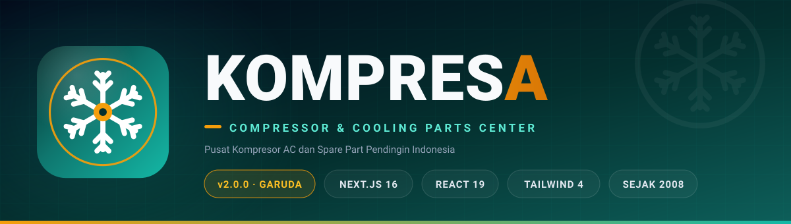
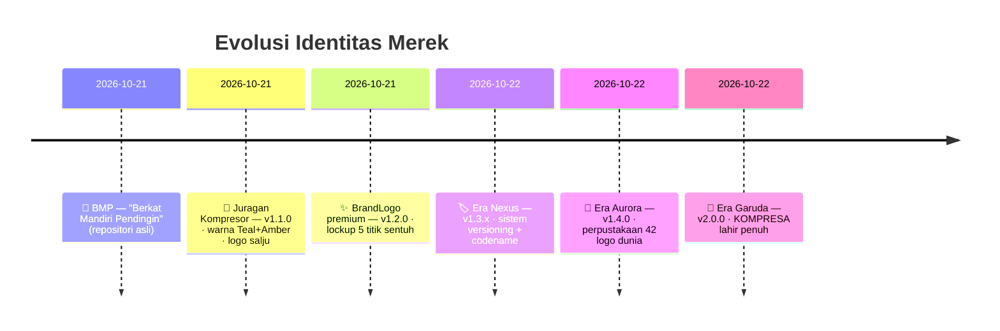
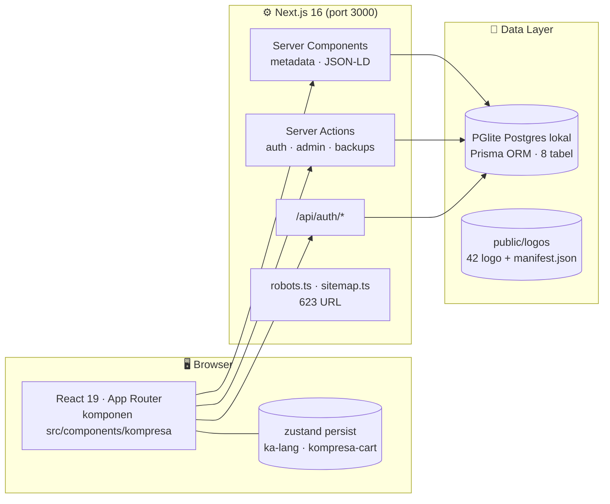
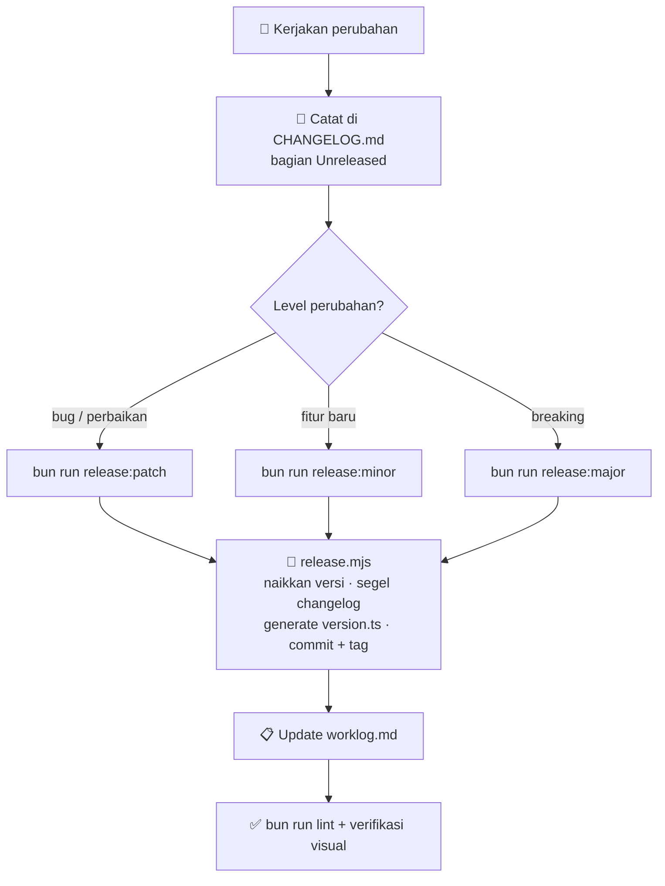

<a id="atas"></a>
<div align="center">



# KOMPRESA

**THE COMPRESSOR & COOLING PARTS CENTER**
*« Pusat Kompresor AC dan Spare Part Pendingin Indonesia »*

[](#-riwayat-rilis)
[](https://nextjs.org)
[](https://react.dev)
[](https://www.typescriptlang.org)
[](https://tailwindcss.com)
[](https://bun.sh)
[](https://github.com/electric-sql/pglite)
[](docs/VERSIONING.md)
[](CHANGELOG.md)
[](docs/VERSIONING.md#6-format-pesan-commit-conventional-commits)

**[🚀 Kilas Singkat](#kilas-singkat) · [🏗️ Arsitektur](#arsitektur) · [🖼️ Logo Dunia](#logo-library) · [🏷️ Versioning](#versioning) · [🛡️ Keamanan](#keamanan) · [🗺️ Roadmap](#roadmap)**

*Repositori: `prabudanling/bmp` — dibangun dengan ❄️ dinginnya refrigeran dan ⚡ hangatnya emas, di Indonesia.*

</div>

---

> **KOMPRESA** adalah situs katalog & e-commerce HVAC generasi baru: **620 produk kompresor dan spare part pendingin dari 25 merek dunia**, dwibahasa penuh (🇮🇩/🇬🇧), SEO lima lapis, CMS admin mandiri, perpustakaan 42 logo merek resmi terverifikasi, dan **sistem versioning kelas industri** dengan codename rilis bergaya Ubuntu/Android — semuanya dalam satu repositori Next.js 16 yang rapi.

<details open>
<summary><b>📑 Daftar Isi</b></summary>

| &nbsp; | &nbsp; | &nbsp; |
|:---|:---|:---|
| [🚀 Kilas Singkat](#kilas-singkat) | [🏗️ Arsitektur Sistem](#arsitektur) | [🗂️ Peta Kode & Route](#peta-kode) |
| [⚙️ Menjalankan Proyek](#quickstart) | [🔧 Perintah CLI](#perintah) | [🛠️ Admin CMS](#admin-cms) |
| [🎨 Sistem Desain](#desain) | [🌍 Dwibahasa (i18n)](#i18n) | [🖼️ Perpustakaan Logo Dunia](#logo-library) |
| [📈 SEO 5 Lapis](#seo) | [🏷️ Versioning & Codename](#versioning) | [📜 Riwayat Rilis](#riwayat-rilis) |
| [🛡️ Keamanan & Pengecualian](#keamanan) | [🗺️ Roadmap](#roadmap) | [🤝 Kontribusi](#kontribusi) |

</details>

---

<a id="kilas-singkat"></a>
## 🚀 Kilas Singkat

```bash
git clone https://github.com/prabudanling/bmp.git kompresa && cd kompresa
bun install && bun run setup      # dependensi + prisma generate + verifikasi aset
bun run dev                       # situs hidup di http://localhost:3000
```

> 💡 Login CMS: `/admin/login` — kredensial dikelola di `.env` (`CMS_ADMIN_*`). Lihat [Admin CMS](#admin-cms).

**Prasyarat:** [Bun](https://bun.sh) ≥ 1.2 · Node.js ≥ 20 (untuk skrip maintenance PGlite — lihat [catatan gotcha](#gotcha-pglite)) · ~600 MB ruang disk (aset produk + database lokal).

| Karakteristik | Nilai |
|:---|:---|
| ⚡ Runtime | Bun 1.x · Next.js 16 (App Router + Turbopack) |
| 🧩 UI | React 19 · TypeScript 5 · Tailwind CSS 4 · shadcn/ui (New York) · Radix UI · framer-motion · lucide-react |
| 💾 Data | PGlite (Postgres WASM lokal) × Prisma ORM 6 · zustand persist |
| 🖥️ Port | `3000` |
| 🧪 Kualitas | ESLint 9 · `bun run lint` · verifikasi visual Agent Browser per rilis |
| 🏷️ Rilis terkini | **v2.0.1 « Garuda »** (2026-10-22, Asia/Bangkok) |

---

<a id="evolusi"></a>
## 🧬 Evolusi Merek: Dari BMP ke KOMPRESA

Repositori ini telah melewati **tiga era rebranding total** — dan setiap era tercatat rapi oleh sistem versioning miliknya sendiri:



| Era | Identitas | Versi | Jejak Artefak |
|:---|:---|:---|:---|
| 0 | 🧱 **BMP** — Berkat Mandiri Pendingin | v0 (pra-rilis) | Repositori asli `prabudanling/bmp` |
| 1 | 🔨 **Juragan Kompresor** | v1.1.0 – v1.4.0 (Genesis → Aurora) | `localStorage jk-lang/juragan-cart` (dimigrasi otomatis), 500 badge gambar "JK" |
| 2 | 🇮🇩 **KOMPRESNUSA** | jembatan intra-v2 (pivot saat proses) | Kunci storage `kn-*` (dimigrasi) |
| 3 | 🦅 **KOMPRESA** | **v2.0.0+ (era Garuda)** | Identitas aktif: wordmark `KOMPRES`+`A`, `ka-lang`, `kompresa-cart`, `admin@kompresa.com` |

> 📚 Filosofi: **Garuda** = era kedua dari pool MAJOR (Genesis → **Garuda** → Nusantara → Majapahit → Sriwijaya → Bhinneka) — jangkauan nasional 38 provinsi, semangat kebangsaan di industri pendingin.

---

<a id="fitur"></a>
## ✨ Fitur Unggulan

| | Fitur | Deskripsi |
|:---:|:---|:---|
| 🛒 | **Katalog & Keranjang** | 620 produk, 25 merek, filter kategori (110 varian scroll), drawer keranjang + toast + subtotal real-time |
| 🌍 | **Dwibahasa Penuh** | 🇮🇩/🇬🇧 — **184 kunci kamus** terpusat (`src/lib/i18n.ts`), preferensi tersimpan & bermigrasi otomatis antar era rebrand |
| 🖼️ | **Perpustakaan Logo Dunia** | 42 logo merek resmi terverifikasi (pipeline 5 sumber + manifest `sha256`) + galeri interaktif & paket ZIP |
| 📈 | **SEO 5 Lapis** | Metadata + OpenGraph + JSON-LD (Product/Offer/FAQ/Breadcrumb/WebSite/Organization) + `sitemap.xml` 623 URL + `robots.ts` + `llms.txt` |
| 🛠️ | **CMS Admin Mandiri** | Kelola 620 produk, artikel, pengaturan situs, backup Dropbox, panduan SEO, image intelligence |
| 🔐 | **Auth Lokal Aman** | Cookie sesi **HMAC-SHA256 timing-safe** — nol dependensi infrastruktur cloud |
| 🏷️ | **Versioning Otomatis** | Satu perintah rilis: SemVer + Keep a Changelog + Conventional Commits + codename + git tag |
| 🎨 | **Desain Sistem Konsisten** | Deep Teal + Amber Gold, wordmark dua-warna, pola anti-hydration terdokumentasi |
| 📱 | **Mobile-First Responsif** | Teruji di viewport 390px — wordmark, sheet menu, dan footer tampil sempurna di semua layar |

---

<a id="angka"></a>
## 📊 Proyek dalam Angka

<div align="center">

| **620** | **25** | **512** | **623** |
|:---:|:---:|:---:|:---:|
| 📦 produk aktif | 🏷️ merek dunia | 🖼️ gambar produk | 🗺️ URL sitemap |

| **42** | **8** | **184** | **38** |
|:---:|:---:|:---:|:---:|
| 🖼️ logo terverifikasi | 🗄️ tabel database | 🌍 kunci dwibahasa | 🇮🇩 provinsi terjangkau |

</div>

> Data resmi perusahaan: berdiri **sejak 2008** · **7.439 proyek** selesai · **38 provinsi** seluruh Indonesia · **18+ tahun** pengalaman — konsisten di kode, i18n, JSON-LD, dan database (teraudit nol sisa klaim usang).

---

<a id="arsitektur"></a>
## 🏗️ Arsitektur Sistem



**Aliran utama:**

1. **Rendering** — halaman publik dirender sebagai Server Components dengan metadata + JSON-LD tersemat; interaksi (keranjang, bahasa, modal produk) diambil alih komponen klien.
2. **State klien** — `zustand persist` menyimpan bahasa & keranjang di `localStorage` dengan **migrasi otomatis** dari kunci era lama (`jk-lang` → `ka-lang`).
3. **Data** — Prisma Client di atas **PGlite** (Postgres WASM embed, data di `db/pglite-data/`): tanpa server DB eksternal, siap dikloning dan langsung jalan.
4. **Aset** — 512 gambar produk (`public/images/products/`) + 42 logo merek (`public/logos/`) dengan manifest ber-hash.

---

<a id="peta-kode"></a>
## 🗂️ Peta Kode & Route

```
kompresa/
├── 📁 prisma/                     schema.prisma · seed.ts
├── 📁 db/pglite-data/             💾 data Postgres lokal (di luar git)
├── 📁 public/
│   ├── logos/                     🖼️ 42 logo · manifest.json · ZIP · README
│   ├── logo-gallery.html          galeri interaktif logo (filter · unduh · ZIP)
│   └── images/products/           512 gambar produk (webp/png)
├── 📁 scripts/
│   ├── release.mjs                🏷️ CLI rilis (SemVer + codename + tag)
│   ├── logo-library/              pipeline kurasi logo (brands.json + builder)
│   ├── check-assets.ts            verifikasi aset pra-deploy
│   └── init-pglite-schema.ts · migrate-sqlite-to-pglite.ts · dsb.
├── 📁 src/
│   ├── app/                       App Router — route di tabel bawah
│   ├── components/kompresa/       🧩 22 komponen merek (Header, Hero, dst.)
│   ├── components/ui/             47+ komponen shadcn/ui
│   ├── components/cms/            editor artikel + form login admin
│   ├── lib/                       db · auth · auth-actions · i18n · cms-db · format
│   ├── stores/                    zustand: lang-store · cart-store
│   └── version.ts                 ⚙️ AUTO-GENERATED (jangan edit manual!)
├── 📁 docs/                       VERSIONING.md · assets/banner.svg
├── CHANGELOG.md · VERSION · worklog.md
└── package.json                   ← sumber kebenaran versi
```

| Route | Jenis | Deskripsi |
|:---|:---|:---|
| `/` | 🏠 Server + Client | Homepage: Hero → Kategori → Produk Unggulan → Merek → Testimoni → Kontak |
| `/produk` | 📦 Katalog | 620 produk + filter kategori + pencarian |
| `/produk/[slug]` | 🔍 Detail | Spesifikasi + JSON-LD `Product`/`Offer`/`FAQ` + modal + tombol keranjang |
| `/insights` · `/insights/[slug]` | 📰 Blog | Artikel & insight HVAC |
| `/admin/login` | 🔐 Auth | Login CMS (server action timing-safe) |
| `/admin` | 🛠️ CMS | Dashboard, produk, artikel, settings, backups, SEO guide, image intelligence |
| `/api/auth/[...path]` | 🔌 API | Endpoint sesi autentikasi |
| `/sitemap.xml` · `/robots.txt` | 🤖 SEO | Dinamis dari database — 623 URL |
| `/logo-gallery.html` | 🖼️ Aset | Galeri statis perpustakaan logo |

---

<a id="quickstart"></a>
## ⚙️ Menjalankan Proyek

```bash
# 1️⃣ Instal dependensi
bun install

# 2️⃣ Setup lengkap (prisma generate + verifikasi aset)
bun run setup

# 3️⃣ (Opsional) push skema database
bun run db:push

# 4️⃣ Jalankan
bun run dev          # http://localhost:3000
```

### Variabel Lingkungan (`.env`)

| Variabel | Kegunaan |
|:---|:---|
| `CMS_ADMIN_EMAIL` | Email login admin CMS |
| `CMS_ADMIN_PASSWORD` | Kata sandi admin (verifikasi timing-safe) |
| `CMS_SESSION_SECRET` | Kunci HMAC-SHA256 penandatanganan cookie sesi |

<a id="gotcha-pglite"></a>
> ⚠️ **GOTCHA KRITIS — PGlite:**
> 1. **14 folder runtime PostgreSQL** (pg_notify, pg_wal, pg_twophase, dst.) **tidak ter-track git**. Setelah clone segar, PGlite gagal init dengan *"could not open directory pg_notify"* — buat ulang folder kosong tersebut, atau jalankan `bun run setup` lalu skrip `scripts/init-pglite-schema.ts`.
> 2. **Skrip maintenance database HARUS lewat `node`** (bukan bun) — PGlite 0.5.11 gagal di runtime Bun namun sukses di Node.

---

<a id="perintah"></a>
## 🔧 Perintah CLI

| Perintah | Fungsi |
|:---|:---|
| `bun run dev` | Dev server (port 3000, log ke `dev.log`) |
| `bun run build` / `start` | Build produksi / serve |
| `bun run lint` | ESLint (selalu nol error sebelum rilis) |
| `bun run setup` | Instalasi + generate + verifikasi aset |
| `bun run db:push` / `db:generate` / `db:seed` | Skema / client / seed Prisma |
| `bun run check:assets` | Verifikasi kelengkapan aset (pra-deploy) |
| `bun run predeploy` | `check:assets` + `lint` sekaligus |
| `bun run release:patch` | 🏷️ Rilis perbaikan → `v2.0.2` |
| `bun run release:minor` | 🏷️ Rilis fitur → `v2.1.0` (codename baru!) |
| `bun run release:major` | 🏷️ Era baru → `v3.0.0` |
| `node scripts/logo-library/build-library.mjs` | Rebuild perpustakaan logo |

---

<a id="admin-cms"></a>
## 🛠️ Admin CMS

Dashboard mandiri di `/admin` — dilindungi cookie **HMAC-SHA256 timing-safe** (tanpa dependensi infrastruktur cloud):

| Modul | Kemampuan |
|:---|:---|
| 📦 **Produk** | Kelola 620 produk: judul, deskripsi, harga, merek, kategori, gambar |
| 📰 **Artikel** | Editor MDX untuk insight HVAC |
| ⚙️ **Pengaturan** | Identitas situs, SEO description, fallback konten |
| 💾 **Backups** | Snapshot database → Dropbox |
| 🧠 **Image Intelligence** | Pemrosesan & penilaian gambar produk otomatis |
| 📈 **SEO Guide** | Panduan optimasi internal untuk tim konten |

> 🔒 Kredensial **tidak pernah** disimpan di kode — seluruhnya di `.env`. Rotasi kata sandi = edit `.env` + restart.

---

<a id="desain"></a>
## 🎨 Sistem Desain

### Palet Identitas

| Token | Warna | Kegunaan |
|:---|:---|:---|
| `#042f2e → #0f766e → #14b8a6` | 🟢 **Deep Teal** (gradien emblem) | Emblem, kepercayaan & kedinginan |
| `#0F766E` / `#0D9488` | 🟢 Teal brand | Primary, header, CTA sekunder |
| `#F59E0B` | 🟡 **Amber Gold** | Aksen premium "juragan": CTA hero, ring emblem, wordmark `A` |
| `#0f172a` / Slate | ⚫ Slate | Teks wordmark `KOMPRES`, latar gelap |

### Aturan Wordmark & Anti-Hydration

- Wordmark: **`KOMPRES`** (solid slate/putih) + **`A`** (gradasi emas `bg-clip-text`) + tagline `COMPRESSOR & COOLING PARTS CENTER`.
- Emblem dipakai lewat `<LogoMark uid="...">` — **uid wajib statis eksplisit per lokasi** (`hdr`, `mnu`, `ftr`).
- ⚠️ **Jangan pernah pakai `useId()` di SVG merek** — posisi pohon bisa beda antara SSR & client (efek `NoSSR`) → id gradien tidak cocok saat hydration. Pola ini memperbaiki bug hydration resmi di v1.3.1 (Nexus).
- Badge jumlah keranjang selalu dibungkus `<NoSSR>` (zustand persist).

---

<a id="i18n"></a>
## 🌍 Dwibahasa (i18n)

| Aspek | Implementasi |
|:---|:---|
| 📖 Kamus | `src/lib/i18n.ts` — **184 kunci** `{ id, en }` terpusat, terkategori (nav, hero, produk, FAQ, dsb.) |
| 🗃️ State | `src/stores/lang-store.ts` — zustand persist, kunci `ka-lang` |
| 🔄 Migrasi | `onRehydrateStorage` memigrasi otomatis kunci era lama (`jk-lang` → `ka-lang`) — preferensi pengguna tidak pernah hilang antar rebrand |
| 🧩 Komponen | `LangSwitcher` di header + sheet mobile; seluruh halaman publik ikut beralih seketika |

---

<a id="logo-library"></a>
## 🖼️ Perpustakaan Logo Dunia

> Rilis **v1.4.0 (Aurora)**: 42 logo merek kompresor & HVAC dunia — **100% brand-akurat**, ternormalisasi seragam, tanpa junk.

| Kategori | Jumlah | Contoh |
|:---|:---:|:---|
| 🌬️ Kompresor Udara | **18** | Atlas Copco, Bitzer (udara), Ingersoll Rand, ABAC, Ceccato… |
| ❄️ Kompresor Pendingin | **9** | Copeland, Danfoss, Maneurop, RefComp, Kulthorn… |
| 🌡️ HVAC & AC | **15** | Daikin, Gree, LG, Samsung, Mitsubishi, Trane, Carrier… |

### Pipeline Kurasi 5 Sumber (presisi → fallback)

1. **Wikipedia infobox** — file logo resmi artikel merek (2 langkah API: images → imageinfo)
2. **Wikipedia auto-search** — ≥2 token nama, blokir entitas salah (tempat/orang)
3. **Wikimedia Commons** — wajib kata "logo", bloklist junk (patung, jam, gedung…)
4. **Favicon resmi domain** — apple-touch-icon situs merek (hash anti-ikon-generik)
5. **Kurasi image-search** — QC visual manual (contact-sheet 4 kandidat/merek)

→ **Normalisasi sharp seragam:** auto-trim pinggiran · maks 640px · PNG palet 256 (~100KB rata-rata) · alpha transparan dipertahankan.

> 🎯 **Keputusan kualitas:** 13 merek tanpa logo terverifikasi (YORK, Tecumseh, Frascold, Sabroe, dst.) **dikeluarkan** — tercatat di `manifest.json` → `failed` — demi kualitas. *Lebih baik rapi & benar daripada penuh & salah.*

**Artefak:** `public/logos/<kategori>/<merek>.png` · `manifest.json` (42 entri + sha256 + sumber) · `public/logos/juragan-kompresor-logo-library.zip` · galeri `/logo-gallery.html` (pencarian, unduh per logo, ZIP).

---

<a id="seo"></a>
## 📈 SEO 5 Lapis

| Lapis | Implementasi |
|:---|:---|
| 1️⃣ Metadata | Title template, description positioning resmi, canonical, OG + Twitter Card |
| 2️⃣ Structured Data | JSON-LD: `WebSite` + `Organization` (foundingDate 2008) + `Product`/`Offer` + `FAQPage` + `BreadcrumbList` |
| 3️⃣ Discoverability | `robots.ts` dinamis · `sitemap.ts` **623 URL** · `llms.txt` untuk mesin jawaban AI |
| 4️⃣ Konten Terstruktur | Heading semantik, alt teks, `lang` alternates ID/EN per URL |
| 5️⃣ Kualitas Data | Angka resmi (2008 · 7.439 · 38 provinsi) konsisten di metadata, JSON-LD, DB, dan kamus i18n |

> 🔗 **Domain kanonis:** `www.juragankompresor.com` — dipertahankan lintas rebrand demi keamanan SEO (aturan: jangan pernah mengubah domain kanonis tanpa arahan pemilik). Lihat [Keamanan & Pengecualian](#keamanan).

---

<a id="versioning"></a>
## 🏷️ Versioning & Codename

Sistem versioning kelas industri — kebijakan lengkap di [`docs/VERSIONING.md`](docs/VERSIONING.md):

| Standar | Penerapan |
|:---|:---|
| **SemVer 2.0.0** | `PATCH` = perbaikan · `MINOR` = fitur baru · `MAJOR` = breaking/rebrand total |
| **Keep a Changelog 1.1.0** | Setiap perubahan wajib dicatat di `[Unreleased]` |
| **Conventional Commits** | `feat · fix · style · refactor · docs · chore · perf · feat!` |
| **Codename** | MINOR: 24 pool "Dingin & Tenaga" · MAJOR: 6 pool era Nusantara |



**Rantai sumber kebenaran** (otomatis oleh `release.mjs`):

```
package.json "version"  ← SUMBER UTAMA
   ├─→ VERSION             (teks cepat: "v2.0.1 (Garuda)")
   ├─→ src/version.ts      (konstanta UI — badge footer)
   └─→ CHANGELOG.md        (riwayat tersegel) + git tag vX.Y.Z
```

### Pool Codename

- **MINOR (24 — "Dingin & Tenaga"):** Nexus · Aurora · Blizzard · Cryo · Glacier · Kelvin · Polar · Subzero · Tundra · Permafrost · Avalanche · Arctic · Snowcap · Zephyr · Iceberg · Frostline · Cirrus · Boreal · Isobar · Absolute · Crystal · Hailstorm · Winteria · Frostbyte
- **MAJOR (6 — era Nusantara):** Genesis · **Garuda** ← era aktif · Nusantara · Majapahit · Sriwijaya · Bhinneka

> 🧊 PATCH mewarisi codename MINOR yang berjalan (gaya *point release* Ubuntu). Override manual: `bun run release:minor -- --name "Frostbyte"`.

---

<a id="riwayat-rilis"></a>
## 📜 Riwayat Rilis

| Versi | Codename | Tanggal | Ringkasan | Compare |
|:---|:---:|:---:|:---|:---:|
| v1.0.0 | *Genesis* | 2026-10-21 | Instalasi repositori — 620 produk, SEO 5 lapis, dwibahasa, CMS | [🔗](https://github.com/prabudanling/bmp/releases/tag/v1.0.0) |
| v1.1.0 | *Genesis* | 2026-10-21 | Rebrand total BMP → Juragan Kompresor + palet Teal/Amber + logo + auth lokal | [🔗](https://github.com/prabudanling/bmp/compare/v1.0.0...v1.1.0) |
| v1.2.0 | *Genesis* | 2026-10-21 | Lockup `BrandLogo` premium di 5 titik sentuh | [🔗](https://github.com/prabudanling/bmp/compare/v1.1.0...v1.2.0) |
| v1.3.0 | **Nexus** | 2026-10-22 | Sistem versioning internasional + CLI rilis | [🔗](https://github.com/prabudanling/bmp/compare/v1.2.0...v1.3.0) |
| v1.3.1 | **Nexus** | 2026-10-22 | Sistem codename + fix hydration emblem (uid statis) | [🔗](https://github.com/prabudanling/bmp/compare/v1.3.0...v1.3.1) |
| v1.3.2 | **Nexus** | 2026-10-22 | Data resmi: 2008 · 7.439 proyek · 38 provinsi (±190 titik) | [🔗](https://github.com/prabudanling/bmp/compare/v1.3.1...v1.3.2) |
| v1.4.0 | **Aurora** | 2026-10-22 | Perpustakaan 42 logo dunia + pipeline kurasi 5 sumber | [🔗](https://github.com/prabudanling/bmp/compare/v1.3.2...v1.4.0) |
| v2.0.0 | 🦅 **Garuda** | 2026-10-22 | Era baru: rebrand total **KOMPRESA** — nol jejak merek lama | [🔗](https://github.com/prabudanling/bmp/compare/v1.4.0...v2.0.0) |
| v2.0.1 | 🦅 **Garuda** | 2026-10-22 | README tier-max + banner brand + dokumentasi arsitektur | [🔗](https://github.com/prabudanling/bmp/compare/v2.0.0...v2.0.1) |

> Detail lengkap tiap versi: [`CHANGELOG.md`](CHANGELOG.md) — format Keep a Changelog, zona waktu Asia/Bangkok.

---

<a id="keamanan"></a>
## 🛡️ Keamanan & Pengecualian Terdokumentasi

Audit v2.0.0 (Garuda) menghasilkan **nol jejak merek lama di antarmuka aktif**. Empat pengecualian sengaja dipertahankan & terdokumentasi:

| # | Pengecualian | Alasan | Status |
|:---:|:---|:---|:---:|
| 1 | 🌐 Domain kanonis `www.juragankompresor.com` (10 titik) | Aturan keamanan SEO — jangan ubah domain kanonis tanpa arahan pemilik | ⏳ menunggu domain resmi |
| 2 | 🏷️ Watermark internal `jk-product-catalog-v1` | Kunci teknis di database, bukan teks publik | ✅ aman |
| 3 | 🖼️ Badge "JK" tertanam di ~500 gambar produk | Butuh regenerasi massal `sharp` (~512 file) | 🗓️ roadmap |
| 4 | 📚 Teks historis di `CHANGELOG.md` / `worklog.md` | Riwayat rilis — prinsip Keep a Changelog: jejak tidak ditulis ulang | ✅ by design |
| 5 | 📦 Nama file ZIP `juragan-kompresor-logo-library.zip` | Kompatibilitas tautan galeri; temuan audit README v2.0.1 | 🗓️ roadmap |

### Praktik Keamanan Aktif

- 🔐 Kredensial admin **hanya di `.env`** — dilarang keras commit kredensial; email lama dinonaktifkan tiap rotasi.
- 🛡️ Verifikasi sesi **timing-safe** + HMAC-SHA256 bertanda tangan.
- 🚫 `src/version.ts` auto-generated — **dilarang edit manual** (aturan versi).

---

<a id="roadmap"></a>
## 🗺️ Roadmap

- [ ] 🌐 **Domain resmi KOMPRESA** + strategi redirect 301 dari domain kanonis lama
- [ ] 🖼️ **Regenerasi badge gambar produk** (sharp, ~512 file) → badge "KA"
- [ ] 📊 **Pengukuran Core Web Vitals** nyata (LCP ≤ 2.5s · INP < 200ms · CLS < 0.1) + Google Search Console & analytics — *dengan ID terverifikasi, tanpa placeholder*
- [ ] 📦 Rebuild perpustakaan logo: targeting 13 merek yang ditunda + rename ZIP
- [ ] 💳 Integrasi pembayaran & checkout penuh
- [ ] 💬 Integrasi WhatsApp Business API (nomor resmi dari pemilik)
- [ ] 🧪 Suite pengujian E2E permanen

---

<a id="kontribusi"></a>
## 🤝 Kontribusi

Proyek ini memakai alur kerja disiplin — **satu perubahan = satu jejak**:

1. 🔀 Buat branch dari `main`
2. 🔧 Kerjakan perubahan + **catat di `CHANGELOG.md` → `[Unreleased]`** (kategori: Added/Changed/Fixed/Removed/Deprecated/Security)
3. ✅ `bun run lint` — wajib nol error
4. 🏷️ Rilis via `bun run release:patch|minor|major` (otomatis: bump, tag, changelog)
5. 📋 Update `worklog.md` (templat terstruktur — lihat [docs/VERSIONING.md §5](docs/VERSIONING.md))

| Type commit | Kapan | Efek versi |
|:---|:---|:---:|
| `feat` | Fitur baru | MINOR |
| `fix` | Perbaikan bug | PATCH |
| `style` / `refactor` / `docs` / `perf` | Tampilan / internal / dokumentasi / performa | PATCH |
| `feat!` | Breaking change | MAJOR |

---

## 📄 Lisensi

**Proprietary — © 2026 PT Kompresa.** Seluruh hak cipta dilindungi.
Kode, aset merek, dan konten katalog hanya untuk penggunaan internal proyek. Perjanjian lisensi tertulis diperlukan untuk penggunaan lain.

---

<div align="center">

<sub><b>KOMPRESA</b> · THE COMPRESSOR & COOLING PARTS CENTER · <a href="#atas">⬆ kembali ke atas</a></sub>

<sub>Dibangun dengan ❄️ + ⚡ oleh tim Kompresa · Era <b>Garuda</b> · <code>v2.0.1</code> · 2026</sub>

</div>
